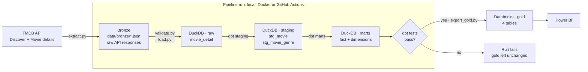
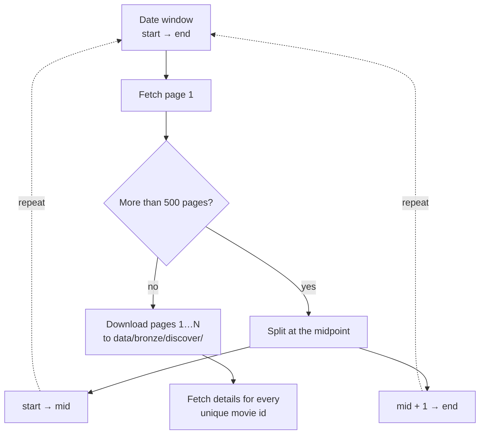
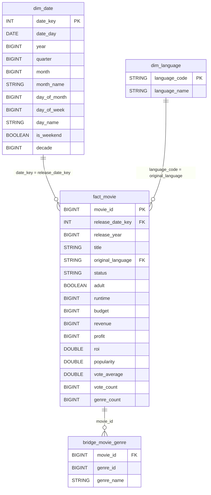
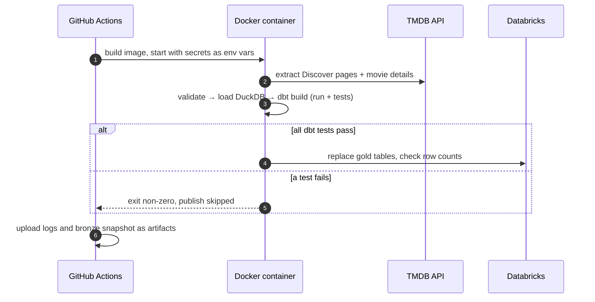
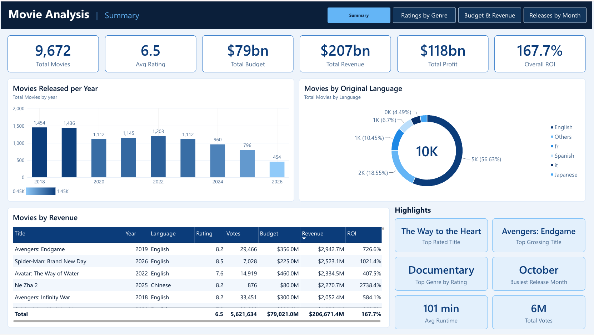
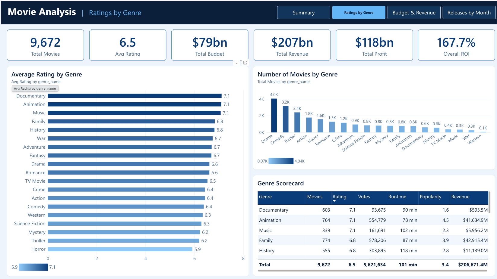
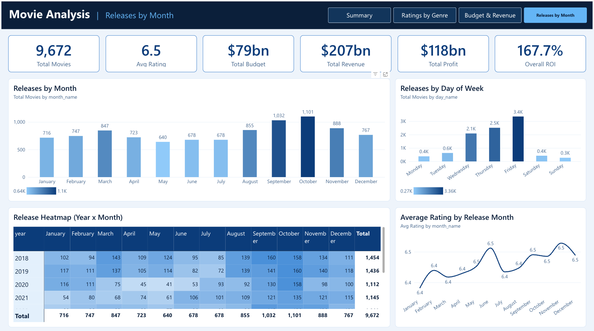

# End-to-end Movie Analysis

An ELT pipeline for movies released from 1 January 2018 through the day the job runs. It pulls data from [The Movie Database (TMDB)](https://www.themoviedb.org/) API into a local DuckDB warehouse, transforms and tests it with dbt, and publishes a star schema to Databricks for a Power BI dashboard.

Link to dashboard: [Dashboard](https://app.powerbi.com/view?r=eyJrIjoiY2UyYzdlYjMtZWRmMy00ZTU4LTgyZTEtZjM1YWY1MTcwNmUxIiwidCI6ImVhNWI1ODBhLTIzMmEtNGUwNy05ZTJkLThjNjIwMGMxZDVmNCJ9)

**Stack:** Python · DuckDB · dbt · Databricks · Power BI · Docker · GitHub Actions · Apache Airflow

## System design


## Pipeline

The project follows a medallion layout. Bronze and silver stay inside the job. Only gold leaves it.



| Step | Code | Output | What it does |
| --- | --- | --- | --- |
| Extract | `src/extract.py` | `data/bronze/` | Saves raw Discover pages and one movie-detail JSON per movie, unchanged |
| Validate | `src/validate.py` | (pass or fail) | Fails the run if bronze files are missing, empty or inconsistent |
| Load | `src/load.py` | DuckDB `raw.movie_detail` | Copies movie details in as-is, including budget `0`. Duplicate ids are removed |
| Staging | `movie_dbt/models/staging/` | DuckDB `staging` | One row per movie and one row per movie-genre. Turns money and runtime `0` into null |
| Marts | `movie_dbt/models/marts/` | DuckDB `marts` | Star schema: `fact_movie`, `bridge_movie_genre`, `dim_date`, `dim_language` |
| Test | dbt tests | (pass or fail) | Unique keys, required columns, valid relationships, no zero budget or revenue left in staging |
| Publish | `src/export_gold.py` | Databricks `gold` | Replaces the four mart tables and checks that row counts match DuckDB |

Every run is a **full refresh**: staging and marts are rebuilt from `raw`, and the Databricks tables are replaced, never appended to.

### Getting past TMDB's 500-page limit

TMDB Discover returns at most 500 pages (10,000 movies) per search. One request from 2018 to today would stop there and miss the rest. The extract checks the first page of each date window. If the window hits the limit, it splits the window in half and tries again, until every window fits. It then downloads every page of each window.



Only movies with at least `MIN_VOTE_COUNT` TMDB votes (default 50, in `src/config.py`) are kept. That is about 9.7k movies from 2018 and leaves out obscure titles that have no budget or revenue data.

If a crawl is interrupted, the next run with the same start date and filters resumes it. The end date is fixed when the crawl starts, so a resume the next day splits the windows the same way and skips every page already saved. A run after a finished crawl, or with different settings, starts a new crawl and clears the old Discover pages. `--fresh` forces a new crawl.

On a local machine, movie details already in `data/bronze/movie/` are skipped, so a re-run only fetches new movies. The load step only reads details for movies in the current crawl.

## Data model

Gold is a small star schema. `fact_movie` has one row per movie, and the dimensions join to it.



Modelling rules:

- **`fact_movie` is the only table used for sums of money.** `bridge_movie_genre` does not carry revenue, because a movie in several genres would be counted once per genre.
- **Unknown is null, not zero.** TMDB reports a missing budget or revenue as `0`. Staging turns those into null, so averages are not pulled down by fake zeros.
- **`profit` = `revenue − budget`, and `roi` = `profit / budget`.** Both are null when budget or revenue is unknown. They are calculated once, in dbt, so Power BI never defines profit a second time.
- **`dim_date`** covers every day from 1 January of the earliest release year to 31 December of the latest. `day_of_week` uses ISO numbering: 1 = Monday, 7 = Sunday.
- **`dim_language`** maps the common language codes to names. Any code not in the map is shown as the code itself.

## Schedule and orchestration

[`.github/workflows/pipeline.yml`](.github/workflows/pipeline.yml) runs the pipeline in Docker on a GitHub-hosted machine every **Monday at 06:00 UTC+10** (Sunday 20:00 UTC), so no local machine needs to be on. It can also be started by hand from the Actions tab, with publishing turned on or off.



- Logs and dbt results are kept as workflow artifacts for 30 days. The bronze JSON is kept for 90 days, because every GitHub run starts from an empty machine.
- Two runs never overlap.
- [`.github/workflows/ci.yml`](.github/workflows/ci.yml) runs on every push and pull request. It builds the image and checks that the Python compiles and that dbt can parse the project. It needs no secrets.
- The same steps exist for local orchestration in Airflow: [`dags/movie_etl.py`](dags/movie_etl.py). If both schedules are on, both runs publish. That is harmless, because the tables are replaced, but you only need one.

## Analysis

The four pages below are the [Power BI report](https://app.powerbi.com/view?r=eyJrIjoiY2UyYzdlYjMtZWRmMy00ZTU4LTgyZTEtZjM1YWY1MTcwNmUxIiwidCI6ImVhNWI1ODBhLTIzMmEtNGUwNy05ZTJkLThjNjIwMGMxZDVmNCJ9). Money is summed from `fact_movie`, so each movie counts once. Genre charts read `bridge_movie_genre`, so a film with several genres appears in each of them.

The published set is **9,672 movies** released from 1 January 2018, each with at least 50 TMDB votes. 2026 stops at the last pipeline run. Counts for 2024 onward are also light, because many new releases have not yet reached 50 votes.

### Summary



The average rating is **6.5**, the average runtime is **101 minutes**, and the films have **5.6 million** votes between them.

Reported budget is **$79 billion** and reported revenue is **$207 billion**. Profit is **$118 billion** and overall ROI is **167.7%**. Profit and ROI use only movies where both budget and revenue are known. The headline budget and revenue each add every movie that has that one figure, including titles where the other figure is missing. An unknown amount is null, so it never enters an average as a zero.

Releases ran at about 1,450 films in 2018 and 2019, fell to 1,112 in 2020, and stayed around 1,100–1,200 through 2023 (1,145, 1,203, 1,112). After that the vote filter shows through: 960 in 2024, 796 in 2025, and 454 so far in 2026.

English is the original language of 57% of titles. French is about 10%, Spanish 7% and Italian 4%. The rest, about 22%, is spread across other languages.

The highest grossing titles are franchises:

| Title | Year | Budget | Revenue | ROI |
| --- | --- | --- | --- | --- |
| Avengers: Endgame | 2019 | $356m | $2.94bn | 727% |
| Spider-Man: Brand New Day | 2026 | $225m | $2.52bn | 1,021% |
| Avatar: The Way of Water | 2022 | $460m | $2.33bn | 408% |
| Ne Zha 2 | 2025 | $80m | $2.27bn | 2,738% |
| Avengers: Infinity War | 2018 | $300m | $2.05bn | 584% |

*Ne Zha 2* is the one that breaks the pattern: a large gross on a mid-size budget. The top-rated card, *The Way to the Heart*, is the film with the highest `vote_average`. Every title counts equally in that ranking, from 50 votes upward.

### Ratings by genre



Genre is where the ratings actually move. Documentary, Animation and Music average **7.1**. Horror, the lowest of the large genres, averages **5.9**. Drama is the most common tag (about 4,000 films), then Comedy (about 3,200) and Thriller (about 2,400).

Rating and revenue describe different films. Documentary's 603 titles average 7.1 and about **$594 million** of revenue, with a popularity of 1.6. Animation (764 films, the same 7.1 average) accounts for about **$42 billion**. Family is close to that revenue, about **$43 billion**, at a 6.8 rating. A film tagged both Animation and Family sits in both totals, which is why the scorecard total stays the 9,672 movies in `fact_movie`.

### Budget and revenue


Profit was about **$22 billion** in 2018 and **$23 billion** in 2019, fell to about **$2 billion** in 2020, and then climbed back through the low tens of billions. In every year except 2020, total revenue sits well above total budget. On the scatter, most films sit under $100 million of budget. Past $200 million the points thin out, and revenue spreads widely at every budget.

The ROI table answers a different question. Its top rows are micro-budget films: *Obsession* (2026) is listed at a budget under $1 million against about $525 million of revenue, a 69,840% ROI, and *Skinamarink* (2023) and *Freaks* (2019) follow the same shape, with budgets that round to zero on the page. ROI divides by budget, so a very small budget produces a huge ratio. The profit line is the read on the scale of the business. The ROI ranking is meaningful among films of a similar budget, which is where *Ne Zha 2* stands out against the other billion-dollar titles.

### Releases by month



**October** is the busiest month (1,101 releases), then September (1,032) and November (888). May is the quietest (640). **Friday** is the release day, about 3,400 films, against about 2,500 on Thursday and 2,100 on Wednesday. Saturday and Sunday together are under 800. Average rating by month only moves between 6.4 and 6.6, so the calendar shifts how many films come out, and leaves the scores almost flat.

The year-by-month heatmap pins 2020 down to the spring. January and February match other years (116 and 111). March drops to 75, April to 45 and May to 41, and the autumn months return to a normal range. Those films have had years to pass the 50-vote filter, so that hole is the release calendar.

## Repository layout

```text
.
├── src/
│   ├── config.py           paths, start date, loads .env
│   ├── extract.py          TMDB → data/bronze/
│   ├── validate.py         bronze checks
│   ├── load.py             bronze → DuckDB raw
│   └── export_gold.py      DuckDB marts → Databricks gold
├── movie_dbt/
│   ├── models/staging/     silver: stg_movie, stg_movie_genre, sources, tests
│   ├── models/marts/       gold: fact, bridge and dimensions, tests
│   ├── tests/              custom SQL tests
│   ├── macros/             schema naming (staging / marts, no prefix)
│   └── profiles.yml        DuckDB connection (path from DUCKDB_PATH)
├── scripts/run_pipeline.sh runs every step in order, stops on first failure
├── dags/movie_etl.py       Airflow DAG (local)
├── .github/workflows/      ci.yml, pipeline.yml
├── Dockerfile
└── requirements.txt        pinned versions
```

`data/`, `logs/`, `.env` and `*.duckdb` are gitignored. The warehouse and bronze files are rebuilt by the pipeline.

## Run locally

Python 3.12 and a virtual environment:

```bash
python3 -m venv .venv
source .venv/bin/activate
pip install -r requirements.txt
```

Copy the template and fill in the values. Never commit `.env`.

```bash
cp .env.example .env
```

| Variable | Value |
| --- | --- |
| `READACCESS_TOKEN` | TMDB API read access token |
| `DATABRICKS_SERVER_HOSTNAME` | SQL warehouse host, without `https://` |
| `DATABRICKS_HTTP_PATH` | SQL warehouse HTTP path |
| `DATABRICKS_TOKEN` | Databricks personal access token |
| `DATABRICKS_CATALOG` | A catalog you can write to |
| `DATABRICKS_SCHEMA` | `gold` |

Run the whole pipeline:

```bash
bash scripts/run_pipeline.sh
```

`SKIP_PUBLISH=1 bash scripts/run_pipeline.sh` stops after the dbt tests and does not write to Databricks. The publish step needs the SQL warehouse to be running, or set to start automatically.

Or run one step at a time:

```bash
python -m src.extract                      # crawl from 2018-01-01 to today
python -m src.extract --start 2000-01-01   # different start date, still ending today
python -m src.extract --min-votes 20       # wider vote filter (more movies, longer run)
python -m src.extract --fresh              # new crawl instead of resuming an unfinished one
python -m src.validate
python -m src.load
cd movie_dbt && dbt build && cd ..         # staging + marts + tests
python -m src.export_gold
```

The default start date is `RELEASE_START` and the default vote filter is `MIN_VOTE_COUNT`, both in `src/config.py`.

## Docker

```bash
docker build -t movie-pipeline .
# test run, no Databricks writes
docker run --rm --env-file .env -e SKIP_PUBLISH=1 -v movie-data:/app/data -v movie-logs:/app/logs movie-pipeline
# full run, publishes gold
docker run --rm --env-file .env -v movie-data:/app/data -v movie-logs:/app/logs movie-pipeline
```

The `movie-data` volume keeps `data/` between containers, so an interrupted run resumes and later runs skip movie details they already have. Without `-v`, every container starts from an empty `data/`. `docker volume rm movie-data` starts over.

The image does not contain `.env` or any secrets. The variables are passed in at run time.

## GitHub Actions secrets

In the repository, go to **Settings → Secrets and variables → Actions** and create one secret for each variable in the table above. The workflow passes them into the container as environment variables. A scheduled run always publishes to Databricks. A manual run can turn publishing off.
