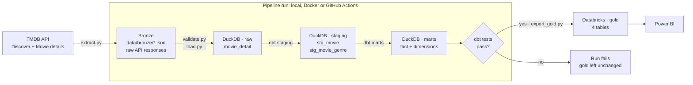
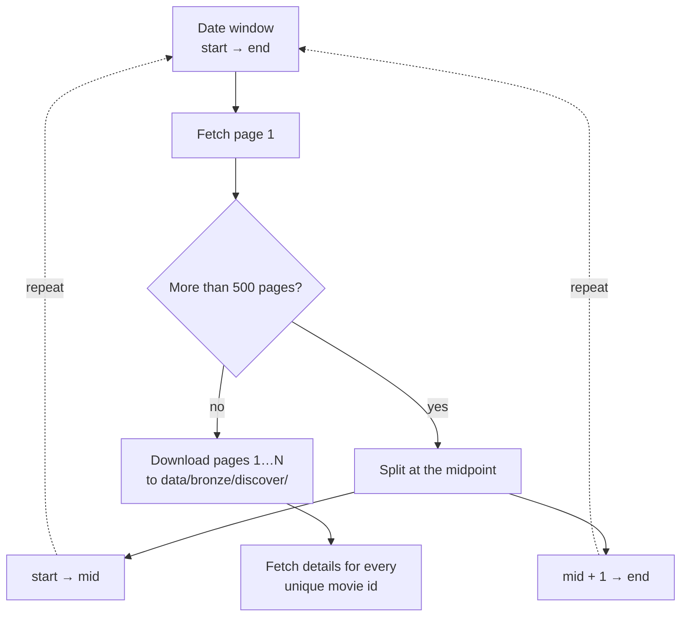
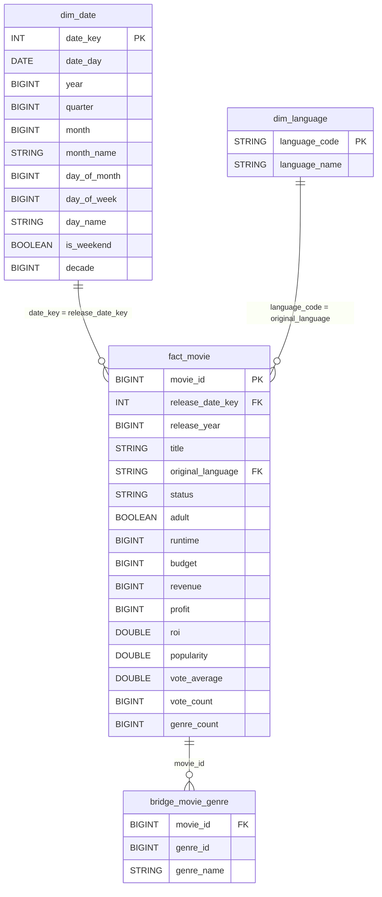
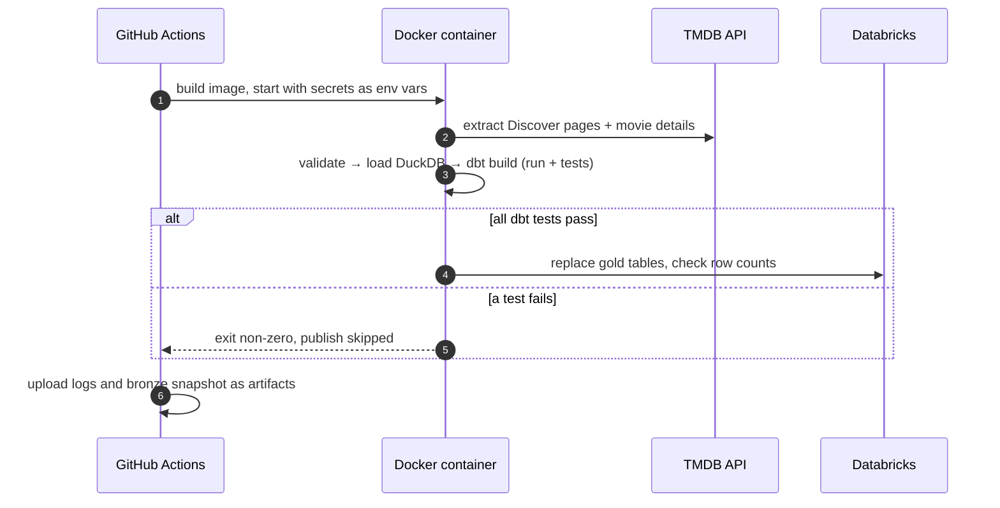

# End-to-end Movie Analysis

An ELT pipeline for movies released from 1 January 2018 through the day the job runs. It pulls data from [The Movie Database (TMDB)](https://www.themoviedb.org/) API into a local DuckDB warehouse, transforms and tests it with dbt, and publishes a star schema to Databricks for a Power BI dashboard.

**Stack:** Python · DuckDB · dbt · Databricks · Power BI · Docker · GitHub Actions · Apache Airflow

## System design


## Pipeline

The project follows a medallion layout. Bronze and silver stay inside the job. Only gold leaves it.



| Step | Code | Output | What it does |
| --- | --- | --- | --- |
| Extract | `src/extract.py` | `data/bronze/` | Saves raw Discover pages and one movie-detail JSON per movie, unchanged |
| Validate | `src/validate.py` | (pass or fail) | Fails the run if bronze files are missing, empty or inconsistent |
| Load | `src/load.py` | DuckDB `raw.movie_detail` | Copies movie details in as-is, including budget `0`. Duplicate ids are removed |
| Staging | `movie_dbt/models/staging/` | DuckDB `staging` | One row per movie and one row per movie-genre. Turns money and runtime `0` into null |
| Marts | `movie_dbt/models/marts/` | DuckDB `marts` | Star schema: `fact_movie`, `bridge_movie_genre`, `dim_date`, `dim_language` |
| Test | dbt tests | (pass or fail) | Unique keys, required columns, valid relationships, no zero budget or revenue left in staging |
| Publish | `src/export_gold.py` | Databricks `gold` | Replaces the four mart tables and checks that row counts match DuckDB |

Every run is a **full refresh**: staging and marts are rebuilt from `raw`, and the Databricks tables are replaced, never appended to.

### Getting past TMDB's 500-page limit

TMDB Discover returns at most 500 pages (10,000 movies) per search. One request from 2018 to today would stop there and miss the rest. The extract checks the first page of each date window. If the window hits the limit, it splits the window in half and tries again, until every window fits. It then downloads every page of each window.



On a local machine, movie details already in `data/bronze/movie/` are skipped, so a re-run only fetches new movies.

## Data model

Gold is a small star schema. `fact_movie` has one row per movie, and the dimensions join to it.



Modelling rules:

- **`fact_movie` is the only table used for sums of money.** `bridge_movie_genre` does not carry revenue, because a movie in several genres would be counted once per genre.
- **Unknown is null, not zero.** TMDB reports a missing budget or revenue as `0`. Staging turns those into null, so averages are not pulled down by fake zeros.
- **`profit` = `revenue − budget`, and `roi` = `profit / budget`.** Both are null when budget or revenue is unknown. They are calculated once, in dbt, so Power BI never defines profit a second time.
- **`dim_date`** covers every day from 1 January of the earliest release year to 31 December of the latest. `day_of_week` uses ISO numbering: 1 = Monday, 7 = Sunday.
- **`dim_language`** maps the common language codes to names. Any code not in the map is shown as the code itself.

## Schedule and orchestration

[`.github/workflows/pipeline.yml`](.github/workflows/pipeline.yml) runs the pipeline in Docker on a GitHub-hosted machine every **Monday at 06:00 UTC+10** (Sunday 20:00 UTC), so no local machine needs to be on. It can also be started by hand from the Actions tab, with publishing turned on or off.



- Logs and dbt results are kept as workflow artifacts for 30 days. The bronze JSON is kept for 90 days, because every GitHub run starts from an empty machine.
- Two runs never overlap.
- [`.github/workflows/ci.yml`](.github/workflows/ci.yml) runs on every push and pull request. It builds the image and checks that the Python compiles and that dbt can parse the project. It needs no secrets.
- The same steps exist for local orchestration in Airflow: [`dags/movie_etl.py`](dags/movie_etl.py). If both schedules are on, both runs publish. That is harmless, because the tables are replaced, but you only need one.

## Repository layout

```text
.
├── src/
│   ├── config.py           paths, start date, loads .env
│   ├── extract.py          TMDB → data/bronze/
│   ├── validate.py         bronze checks
│   ├── load.py             bronze → DuckDB raw
│   └── export_gold.py      DuckDB marts → Databricks gold
├── movie_dbt/
│   ├── models/staging/     silver: stg_movie, stg_movie_genre, sources, tests
│   ├── models/marts/       gold: fact, bridge and dimensions, tests
│   ├── tests/              custom SQL tests
│   ├── macros/             schema naming (staging / marts, no prefix)
│   └── profiles.yml        DuckDB connection (path from DUCKDB_PATH)
├── scripts/run_pipeline.sh runs every step in order, stops on first failure
├── dags/movie_etl.py       Airflow DAG (local)
├── .github/workflows/      ci.yml, pipeline.yml
├── Dockerfile
└── requirements.txt        pinned versions
```

`data/`, `logs/`, `.env` and `*.duckdb` are gitignored. The warehouse and bronze files are rebuilt by the pipeline.

## Run locally

Python 3.12 and a virtual environment:

```bash
python3 -m venv .venv
source .venv/bin/activate
pip install -r requirements.txt
```

Copy the template and fill in the values. Never commit `.env`.

```bash
cp .env.example .env
```

| Variable | Value |
| --- | --- |
| `READACCESS_TOKEN` | TMDB API read access token |
| `DATABRICKS_SERVER_HOSTNAME` | SQL warehouse host, without `https://` |
| `DATABRICKS_HTTP_PATH` | SQL warehouse HTTP path |
| `DATABRICKS_TOKEN` | Databricks personal access token |
| `DATABRICKS_CATALOG` | A catalog you can write to |
| `DATABRICKS_SCHEMA` | `gold` |

Run the whole pipeline:

```bash
bash scripts/run_pipeline.sh
```

`SKIP_PUBLISH=1 bash scripts/run_pipeline.sh` stops after the dbt tests and does not write to Databricks. The publish step needs the SQL warehouse to be running, or set to start automatically.

Or run one step at a time:

```bash
python -m src.extract                      # crawl from 2018-01-01 to today
python -m src.extract --start 2000-01-01   # different start date, still ending today
python -m src.validate
python -m src.load
cd movie_dbt && dbt build && cd ..         # staging + marts + tests
python -m src.export_gold
```

The default start date is `RELEASE_START` in `src/config.py`.

## Docker

```bash
docker build -t movie-pipeline .
docker run --rm --env-file .env -e SKIP_PUBLISH=1 movie-pipeline   # test run, no Databricks writes
docker run --rm --env-file .env movie-pipeline                     # full run, publishes gold
```

The image does not contain `.env` or any secrets. The variables are passed in at run time.

## GitHub Actions secrets

In the repository, go to **Settings → Secrets and variables → Actions** and create one secret for each variable in the table above. The workflow passes them into the container as environment variables. A scheduled run always publishes to Databricks. A manual run can turn publishing off.
